  

  

### 🧠 Can you think like someone else?

*Understanding a mind means knowing that what someone believes can be different from what you know.*

Imagine this:

Sana puts a chocolate bar in a **drawer** and leaves the room. While she's away, Alex moves it into a **cupboard**.

Sana hasn't seen this happen.

  

**Where will Sana look for the chocolate?**

🧩 Reveal the answer

**The drawer.**

You know the chocolate is in the cupboard, but Sana doesn't. To predict her behaviour, you have to reason about *her belief*, not simply the state of the world.

This is a classic false-belief task, used to study **Theory of Mind** — our ability to attribute beliefs, knowledge, and intentions to others.

🔍 Why is this interesting?

The challenge isn't remembering where the chocolate is. It's keeping track of two different representations of reality:

- **The world:** The chocolate is in the cupboard.
- **Sana's belief:** The chocolate is still in the drawer.

Humans navigate these differences constantly. For AI, the question is whether a system can reliably represent another agent's perspective, reason about what it knows, and adapt its predictions accordingly.

🤖 Could an AI solve this?

Getting the right answer once doesn't necessarily mean a model understands another mind.

I'd want to ask:

- Does it track who has seen what?
- Can it distinguish another person's belief from reality?
- Does it still reason correctly when the story changes?
- Can we inspect *why* it predicts a particular action?

These are the kinds of questions that make Theory of Mind, cognitive modelling, and interpretable AI so interesting to me.

### 🔬 What I'm exploring

- **Theory of Mind:** How do we reason about other people's beliefs, knowledge, and intentions?
- **Cognitive modelling:** Can computational models help explain how human cognition works?
- **Interpretable AI:** Can we understand the representations and reasoning behind a model's predictions?
- **Neuroscience:** What can the mechanisms of the brain tell us about intelligence?

### 🛠️ Things I've built

- **[How Do We Hear a Rāga?](https://github.com/krsnkkv/HowDoWeHearARaga)** — An interpretable cognitive model of how listeners recognise melodies. *MEng Final Year Project · First Class*
- **[Our Patch](https://github.com/krsnkkv/Adahack-Postcode)** — A gamified street-greening map, winner of the Postcode Lottery challenge at ADA Hack 2026.
- **[FemmeVenture](https://github.com/krsnkkv/FemmeVenture)** — A full-stack platform designed around women travelling solo.
- **[More projects →](https://github.com/krsnkkv/Projects)**

### ⚡ Currently building

A spiking neuron simulator in Python to explore how neurons integrate signals and generate action potentials.

  

### 📫 Find me

  
  

  

